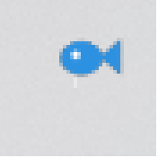

# 异环自动钓鱼 (NTE AutoFish)

<p align="center"></p>

> **异环自动钓鱼 × Neverness to Everness auto fishing bot**
>
> 《异环》自动钓鱼工具 — 纯屏幕识别 + 模拟键鼠，**不读游戏内存、不注入 DLL、不修改游戏文件**。
>
> Screen-vision based auto fishing for *Neverness to Everness* (NTE). No memory reading, no DLL injection, no game file modification. Windows 10/11 · C# · .NET Framework 4.x

## 功能

- 自动抛竿、判定咬钩、提竿
- 搏斗时按 A/D 追踪绿区（约 60 帧/秒的画面轮询）
- 自动关闭结算卡片，循环下一轮
- 自动处理「钓鱼准备」界面（点「开始钓鱼」）
- 没鱼饵 / 长时间没咬钩时**自动停手**，不乱按
- **托盘图标控制**，没有黑窗口

## 不做什么

- **不自动买鱼饵、不自动更换鱼饵**。请自备足够的鱼饵再启动。
- 不走位、不找钓鱼点、不处理背包 / 商店 / 任务。

## 使用方法

1. Windows 10 / 11，需要 .NET Framework 4.x（系统自带）
2. 打开《异环》，走到钓鱼点，**手动进入钓鱼模式**（按 `F` → 选「钓鱼」，右下角出现 `R Q E F`）
3. 双击 `NteAutoFish.exe`，UAC 弹窗点「是」（必须管理员运行，否则按键无法送达游戏）
4. 屏幕右下角托盘出现**鱼形图标**，说明已启动
5. 右键托盘图标 →「开始钓鱼」（或双击图标、或按 `F12`）
6. 之后不要动鼠标键盘，让它自己跑

## 托盘菜单

| 菜单项 | 作用 |
|---|---|
| 已上鱼 N 条 | 状态显示（不可点） |
| 开始钓鱼 / 暂停 | 启停 |
| 打开日志 | 用记事本打开 `fish.log` |
| 打开 config.ini | 编辑配置 |
| 退出 | 结束程序 |

`F12` 也能随时启停；双击托盘图标同样可以。

## 配置

首次运行会在 exe 同目录生成 `config.ini`：

```ini
# 多少秒没咬钩就停手
StallSeconds=70
# 结算卡识别阈值（16 = 16%，越大越严格）
CardThresholdPct=16
```

## 日志

托盘右键「打开日志」，或直接看 `fish.log`：

```
engine start (v1.0)
game window 1600x900
FIGHT  green=740..860 tick=798
fight ended after 5s
catch card (score=0.21)
cycle done, caught=1
```

| 日志 | 含义 |
|---|---|
| `FIGHT` | 检测到搏斗条，开始控 A/D |
| `fight ended after Ns` | 一场结束（成功的会紧跟 `catch card`） |
| `cycle done, caught=N` | 成功上鱼 |
| `OUT OF BAIT` | 判定没饵，已停手 |
| `STALL ... without a bite` | 长时间没咬钩，已停手 |
| `heartbeat: ...` | 每 15 秒一次，证明程序还活着 |

## 已知限制

- 游戏窗口必须**可见**，不能最小化、不能被完全遮挡
- 用的是**比例坐标**，分辨率可以不同；但如果改了游戏内 UI 缩放，可能需要重调阈值
- 成功率约 45%（鱼会挣脱，这是机制）
- 只适配**当前版本**的界面布局，游戏更新后可能需要调整

## 风险声明

使用自动化工具可能违反游戏用户协议，存在**封号**风险。请自行评估并承担后果。
本项目仅供个人学习与技术研究，请勿用于商业代练或售卖。

## 编译

不需要 Visual Studio，用 Windows 自带的 C# 编译器：

```bat
cd src
csc /target:winexe /win32manifest:app.manifest /out:..\NteAutoFish.exe ^
    /r:System.Drawing.dll /r:System.Windows.Forms.dll NteAutoFish.cs Engine.cs
```

或直接运行仓库根目录的 `build.bat`。

## 结构

```
src/
  NteAutoFish.cs   入口、托盘、窗口查找、截屏、基础识别
  Engine.cs        钓鱼状态机
  app.manifest     请求管理员权限 + DPI 感知
build.bat          一键编译
```
---

**关键词 / Keywords**

异环 自动钓鱼 钓鱼脚本 · 异环钓鱼辅助 · Neverness to Everness fishing · NTE auto fish · NTE fishing bot · screen vision automation · game bot · C# WinForms